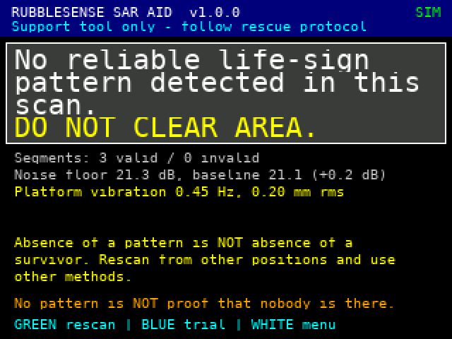
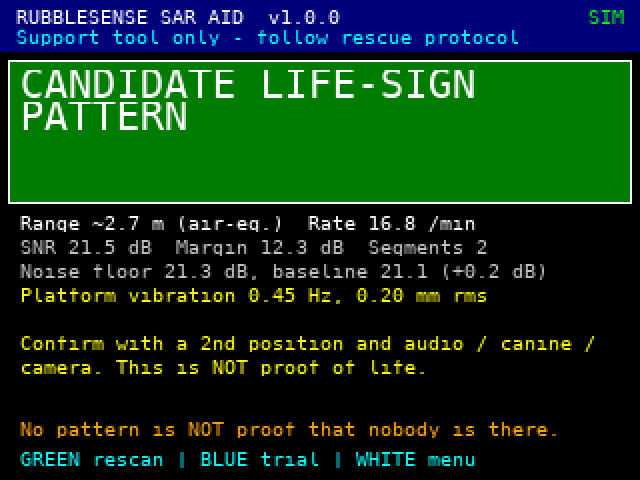

# RubbleSense — arsitektur, keputusan desain, dan status verifikasi

Dokumen ini menjelaskan hasil perbaikan kode dan arsitektur dari sketsa asli (`attachment.txt` + `diagram.json`) agar
alat bantu SAR berbasis radar tanda-hidup ini lebih optimal dan lebih layak dipakai pada kondisi nyata (mencari korban di
reruntuhan). Versi firmware 1.0.0 — dokumen ditulis 24 Oktober 2026.

> **Baca ini dulu — status jujur**
>
> Ini **prototipe riset**, bukan alat penyelamat. Tidak satu pun bagian proyek ini sudah divalidasi pada perangkat keras
> radar, pada manusia, atau pada reruntuhan sungguhan. Seluruh angka kinerja di dokumen ini berasal dari **simulator
> derau Gaussian putih**, dan hanya menjawab "apakah logikanya benar di bawah model itu", **bukan** "seberapa baik alat
> ini menemukan korban". Hasil negatif tidak pernah berarti "tidak ada orang di sini" — itu aturan nomor satu desain
> ini (bagian 3), dan sekaligus kenyataan fisika (bagian 1.3 dan 9).

## Daftar isi

1. [Status dan batasan](#1-status-dan-batasan)
2. [Apa yang berubah dari sketsa asli](#2-apa-yang-berubah-dari-sketsa-asli)
3. [Aturan keselamatan dan cara penegakannya](#3-aturan-keselamatan-dan-cara-penegakannya)
4. [Arsitektur sistem](#4-arsitektur-sistem)
5. [Pipeline DSP](#5-pipeline-dsp)
6. [Keputusan dan keluaran ke operator](#6-keputusan-dan-keluaran-ke-operator)
7. [Protokol serial I/Q dan sumber radar](#7-protokol-serial-iq-dan-sumber-radar)
8. [Verifikasi dan kalibrasi (hanya simulasi)](#8-verifikasi-dan-kalibrasi-hanya-simulasi)
9. [Syarat front-end radar nyata](#9-syarat-front-end-radar-nyata)
10. [Keterbatasan yang diketahui](#10-keterbatasan-yang-diketahui)
11. [Rencana validasi lapangan](#11-rencana-validasi-lapangan)
12. [Cara menjalankan](#12-cara-menjalankan)
13. [Struktur proyek](#13-struktur-proyek)
14. [Rujukan](#14-rujukan)

---

## 1. Status dan batasan

### 1.1 Yang sudah dikerjakan dan diperiksa (di komputer, dengan simulator)

| Hal | Bukti |
|---|---|
| Seluruh rantai sumber I/Q → akuisisi → DSP → keputusan → layar/LED/buzzer → log JSON ditulis ulang | firmware `src/` + inti DSP portabel `lib/rs_core/` |
| Inti DSP: FFT, CFAR, kompensasi getaran, keputusan, IMU, protokol | `make test`: 313 pemeriksaan lulus |
| Firmware yang sama (tanpa diubah) dijalankan di host dengan header Arduino/ESP32 tiruan dan jam virtual | `make harness`: 24 suite, 9.610 pemeriksaan (build UART2) dan 9.626 (build UART0), 0 gagal |
| Kegagalan link dan jam: paket hilang/rusak/ganda/sampah, front-end berhenti, laju frame salah, IMU hilang/terguncang | tabel di `docs/results/harness_uart2.md` dan `harness_uart0.md` |
| Rekaman → aliran byte → firmware, termasuk jalur langsung lewat soket TCP | `make e2e`: 124 pemeriksaan lulus |
| Studi Monte-Carlo (E1–E8), puluhan ribu scan | `docs/results/*.csv`, `montecarlo_summary.md` |
| Firmware dikompilasi `-fsyntax-only` pada 3 lingkungan PlatformIO × jalur perangkat/host × API LEDC Arduino-ESP32 2.x/3.x | `make syntax`: 204 kompilasi bersih |
| Diagram Wokwi dibuat dari peta pin firmware dan diperiksa sebagai netlist | `make check-diagram`: 15 bagian, 38 kabel cocok dengan `src/rs_pins.h` |
| Log scan diperiksa otomatis terhadap janji keselamatan | `tools/validate_scan_log.py` (dijalankan oleh `make harness`) |

### 1.2 Yang BELUM — dan tidak bisa saya kerjakan di lingkungan ini

| Hal | Akibat |
|---|---|
| **Tidak ada front-end radar dan tidak ada data nyata.** | Semua angka kinerja adalah angka simulasi. Tidak ada rekaman reruntuhan, napas manusia, atau klutter nyata. |
| Firmware **belum pernah dikompilasi untuk ESP32** (registri PlatformIO tidak dapat dijangkau). `platformio.ini` belum pernah dibangun. | Build pertama di perangkat adalah pekerjaan Anda; daftar periksanya ada di bagian 12.6. Waktu DSP dan jitter di ESP32 belum diukur. |
| Diagram Wokwi hanya diperiksa sebagai netlist. | Tata letak/koordinat komponen belum dilihat di simulator Wokwi. |
| Jalur `--port` (pyserial, termasuk `rfc2217://`) pada `send_iq_replay.py` belum diuji, karena pyserial tidak bisa dipasang di sini. | Hanya jalur berkas (`--out`) dan TCP (`--tcp`) yang diuji. |
| Semua kalibrasi ambang memakai satu model derau (Gaussian putih, pemantul titik ideal). | Ambang harus dikalibrasi ulang dengan rekaman front-end nyata (bagian 8.4 dan 11). |

### 1.3 Fisika yang tidak bisa diperbaiki oleh perangkat lunak

* **Menembus reruntuhan menuntut front-end berfrekuensi rendah / UWB.** Sistem FINDER (NASA JPL/DHS) memakai radar
  gelombang mikro dan dilaporkan mampu mendeteksi detak jantung dan napas di balik sekitar 9 m (30 kaki) material
  reruntuhan dalam uji coba [1]. Penelitian radar impuls UWB (pusat 400 MHz) mendeteksi tanda vital menembus dinding,
  tetapi juga melaporkan bahwa pada jarak/redaman besar sinyal napas "tidak tampak jelas", gerak dada hanya beberapa
  milimeter, dan SNR rendah menjadi kendala utama [2]. Sumber yang saya temukan menempatkan penginderaan menembus
  dinding pada UWB frekuensi rendah (beberapa GHz ke bawah) dan menyebut rugi transmisi 60 GHz lebih besar [3];
  **saya tidak menemukan klaim bahwa modul 60 GHz dapat menembus puing** — jangan mengandalkannya.
* Perangkat lunak hanya dapat mencegah alat ini **berbohong** (alarm palsu, "aman" palsu, getaran dibaca sebagai napas).
  Ia tidak bisa menciptakan sensitivitas yang tidak dimiliki radar.
* Jarak yang ditampilkan adalah jarak **setara-udara** (*air-equivalent*). Di dalam material berpermitivitas tinggi,
  jarak sebenarnya lebih pendek; angka itu bukan "meter di dalam puing".

---

## 2. Apa yang berubah dari sketsa asli

Sketsa asli menyebut dirinya "simulator alur kerja pemrosesan sinyal lokal" (fase 3–4) dan itu fungsinya. Tabel di bawah
berisi celah yang harus ditutup agar alur yang sama dapat bekerja dengan radar nyata.

| Aspek | Sketsa asli | Sekarang |
|---|---|---|
| **Sumber sinyal** | "Sinyal radar" disintesis di dalam loop dari potensiometer/preset + `random()`: sinus 0,28 Hz buatan yang kemudian "dideteksi". Rantai deteksi hanya bisa menemukan apa yang ditanamnya sendiri. | Data I/Q kompleks per bin jarak lewat antarmuka `IRadarSource`. Dua sumber: simulator (demo/uji) dan **serial I/Q** (front-end nyata, PC pemutar rekaman, atau rig HIL) dengan protokol berpagar CRC (bagian 7). |
| **Lama pengamatan, resolusi** | 6 detik (120 sampel) → resolusi frekuensi ±0,17 Hz; pita 0,15–0,50 Hz hanya memuat ±2 sel independen (DFT tiap 0,025 Hz hanyalah interpolasi). | Segmen 25,6 detik (512 frame @ 20 Hz) → 0,039 Hz per sel; satu scan = minimal **dua segmen independen** (≈ 51 detik). |
| **Pita napas** | 0,15–0,50 Hz (9–30 napas/menit): mengecualikan anak-anak, napas cepat, dan napas lambat. | 0,10–0,80 Hz nominal; sel FFT yang benar-benar dicari 3…20 = 0,117–0,781 Hz (**7,0–46,9/menit**). |
| **Statistik deteksi** | Ambang ad hoc (`SNR ≥ 1,5 dB` dan skor periodisitas `≥ 0,32`) tanpa kendali alarm palsu; "SNR" dibanding energi di pita lain. | **CA-CFAR** dengan probabilitas alarm palsu *keluarga* per segmen = 1 % (dibagi jumlah sel yang diuji), plus konfirmasi terpandu di segmen independen. Ambang terbukti dengan rumus tertutup dan diuji (bagian 5, 8). |
| **"Confidence %"** | Pemetaan sembarang dari skor (mis. `55 + 40·skor + 1,2·SNR`, dijepit 60–94); bahkan hasil negatif menampilkan "confidence". Tidak punya makna statistik, mudah dibaca sebagai peluang. | **Tidak ada persentase.** Bukti ordinal (kuat/sedang/lemah) + margin dB + jumlah segmen yang setuju. |
| **Kestabilan sensor** | Satu "indeks gerak" (jumlah selisih mutlak akselerasi + 2 × nilai mutlak laju sudut) dirata-ratakan dan dibandingkan dengan satu ambang 0,65; bias giroskop tidak dibuang; **bila MPU6050 tidak ada, scan jalan terus** dengan metrik "simulasi" (gagal-terbuka). | IMU dibaca langsung lewat register (tanpa pustaka Adafruit) pada 100 Hz; satuan fisik; bias giroskop dibuang; kemiringan gravitasi dipantau; frame ditandai per-frame dengan masa tahan 0,5 detik; deteksi IMU beku. **IMU hilang ⇒ scan DITOLAK** (gagal-aman). |
| **Getaran platform yang tak terlihat IMU** | Tidak ditangani. | Estimasi *common-phase-error* dari bin lain, kompensasi, uji koherensi platform, uji garis seluruh-adegan → bila tak terpisahkan dari napas: **CONFOUNDED** (bukan kandidat). |
| **Arti hasil negatif** | Cabang `else` menangkap semuanya, berlabel "GOOD (QUIET BASELINE)". | Tidak ada label "baik" pada hasil negatif. Baseline lantai-derau saat kalibrasi; bila lantai naik > 3 dB di atas baseline → **LOW_SENSITIVITY** ("negatif tidak berarti apa-apa"). |
| **Data buruk** | Terserap diam-diam ke hasil. | Kegagalan nyata ⇒ **INVALID_SCAN** dengan alasan spesifik: gerak sensor, ADC jenuh, frame hilang > 2 %, cap waktu tak cocok > 2 %, tak ada sinyal, link berhenti, IMU hilang, konfigurasi tak valid, geometri front-end berubah di tengah scan. |
| **Eksekusi** | Satu fungsi `runScanWorkflow()` yang memblokir dengan `delay()`; menggambar TFT di dalam loop 20 Hz (jika gambar > 50 ms, grid sampling bergeser tanpa terdeteksi); DFT O(N·K). | Tiga task FreeRTOS (akuisisi core 0 prio 4, DSP core 0 prio 2, UI core 1), FFT radix-2, antrean tanpa kunci; nomor urut + cap waktu frame memvalidasi grid sampling. |
| **Peta pin** | `TFT_CS 15`, `TFT_DC 2`, tombol `12` — memakai pin strapping ESP32 (0, 2, 5, 12, 15 menentukan mode boot). | Peta pin baru menghindari pin strapping untuk input yang bisa tertahan saat boot, pot di ADC1, UART0 bebas untuk konsol (bagian 4.5). |
| **Log** | JSON ke Serial saja. | JSON satu baris per scan di LittleFS dengan rotasi (192 KB × 2 generasi) + validator otomatis. |
| **Teks/keselamatan** | Kalimat wajib untuk hasil negatif ada, tetapi tidak ada pemeriksaan otomatis. | Kalimat wajib + pemeriksa klaim berbahaya pada setiap layar, teks, dan log diuji oleh harness dan validator. Bahasa Inggris dan Indonesia. |
| **Label** | "AI-Assisted Radar SAR Aid". | Tidak ada model ML di proyek ini; label itu dihapus. |

Hal yang **sengaja tidak** dikerjakan: Wi-Fi/BLE/aplikasi tablet, deteksi detak jantung (hanya pita napas), pemetaan
multi-korban yang rumit (maks. 4 garis per segmen), dan pelatihan model apa pun.

---

## 3. Aturan keselamatan dan cara penegakannya

Aturan ini adalah isi desain, bukan hiasan. Setiap aturan ditegakkan di kode **dan** diuji.

| # | Aturan | Penegakan |
|---|---|---|
| R1 | **Tidak ada verdict "aman/kosong/bersih".** Hasil paling negatif adalah `NO_RELIABLE_PATTERN` dengan kalimat wajib: *"No reliable life-sign pattern detected in this scan. DO NOT clear area."* | `enum Verdict` tidak punya nilai "clear". Kalimat wajib dikunci di `txt::mandatoryNegativeEn()`. Pemeriksa `dangerousClaim()` di harness menolak frasa klaim tanpa negasi ("all clear", "area is clear", "no survivor", "nobody", "area aman", "tidak ada orang", dst.) pada **setiap** layar dan teks aksi; `validate_scan_log.py` memeriksa log dengan aturan yang sama dan juga menolak angka persentase. |
| R2 | **LED hijau hanya untuk kandidat.** Hasil negatif tidak menyalakan LED apa pun. | `App::applyVerdictAlerts()`; invarian `checkScanInvariants()` (hijau ⇔ kandidat) dijalankan setelah **setiap** scan di semua suite harness. |
| R3 | **Kandidat ≠ kepastian.** Tidak ada persentase; bukti ordinal; setiap kandidat memerintahkan konfirmasi (posisi ke-2, audio, anjing pelacak, kamera) dan menyatakan "bukan bukti kehidupan". | `evidenceName()`, `verdictActionEn()`; diuji. |
| R4 | **Negatif hanya bermakna bila sensitivitas diketahui.** Lantai derau > baseline + 3 dB ⇒ `LOW_SENSITIVITY`. JSON memuat `sensitivity` = `unknown` / `ok` / `low` yang selalu mengikuti angkanya. | `ScanOutcome::low_sens`; invarian di `checkScanInvariants()` dan validator. |
| R5 | **Gagal-aman.** Data tidak layak ⇒ `INVALID_SCAN`, tidak pernah "negatif". IMU hilang, gerak, ADC jenuh, frame hilang > 2 %, cap waktu tak cocok > 2 %, tak ada sinyal, link berhenti, geometri berubah. | Gerbang kualitas di `analyzeSegment()`, `Acquisition`, `SerialIqSource`; puluhan skenario kegagalan di suite `fw_iq_*` dan `fw_imu_faults` (tabel di `docs/results/`). |
| R6 | **Tidak ada pemotongan diam-diam.** Pita cari yang tidak muat di jendela spektral ⇒ konfigurasi ditolak (`config`), bukan dipotong. | `analyzeCore()` dan `paramsValid()`. |
| R7 | **Getaran platform bukan orang.** Garis yang cocok dengan getaran platform tidak pernah menjadi kandidat; bila tak terpisahkan ⇒ `CONFOUNDED`. | Uji koherensi platform + uji seluruh-adegan; skenario E3–E5, E8. |
| R8 | **Hasil tidak pernah diubah oleh antarmuka.** Layar, JSON, LED, dan buzzer semuanya diturunkan dari satu `ScanOutcome`. | `App::finishScan()`; `fw_json`, `fw_ui_screens`. |
| R9 | **Setiap scan tercatat** (LittleFS, bertahan setelah reboot) dan dapat diaudit. | `Storage::append()`, `validate_scan_log.py`. |

Yang **tidak** dijamin oleh aturan ini: bahwa verdict benar. Hanya rekaman reruntuhan dengan kebenaran-dasar (ground truth)
yang dapat menjawab itu (bagian 11).

---

## 4. Arsitektur sistem

### 4.1 Blok dan lapisan

```
 FRONT-END RADAR (MCU sendiri, di luar proyek ini)         PC pemutar rekaman / rig HIL
  I/Q per bin jarak, 20 Hz, + IMU yang dipasang di antena   (tools/send_iq_replay.py)
        |  UART2 460.800 baud (GPIO36 RX, GPIO14 TX)              |  UART0/USB 115.200 baud
        v                                                          v
 +--------------------------------------------------------------------------------------+
 | ESP32 DevKit                                                                         |
 |                                                                                      |
 |  core 0                                          core 1                              |
 |  +---------------------------------+  ring      +----------------------------------+ |
 |  | rs_acq  (prioritas 4, ~1 kHz)   |  konsol    | loop() -> App::update()  (5 ms)  | |
 |  |  RxPump   pembaca UART tunggal  |----------->|  tombol, konsol, mesin status    | |
 |  |  SerialIqSource | SimSource     |            |  ScanSession (keputusan)         | |
 |  |  Acquisition: IMU 100 Hz, tanda |  snapshot  |  Ui (TFT)  Alerts (LED, buzzer)  | |
 |  |   per-frame, frame tahan, macet |----------->|  JSON -> Serial + LittleFS       | |
 |  +----------------+----------------+            |  Settings (NVS)                  | |
 |                   | SegmentBuffer               +----------------+-----------------+ |
 |                   | (tanpa kunci)                               | submit / ambil    |
 |                   v                                             v                   |
 |  +---------------------------------+                                                |
 |  | rs_dsp  (prioritas 2)           |<-----------------------------------------------+
 |  |  analyzeSegment()  lib/rs_core  |                                                |
 |  +---------------------------------+                                                |
 +--------------------------------------------------------------------------------------+
```

Prinsip desain:

1. **Satu inti DSP portabel** (`lib/rs_core`, C++11, tanpa header Arduino). Kode yang persis sama berjalan di ESP32
   dan di komputer; karena itu ambang dan keputusan dapat dievaluasi secara statistik (20.000 scan ruang kosong dalam
   beberapa menit), bukan ditebak.
2. **Semua yang di atas HAL hanya melihat I/Q kompleks.** Antarmuka `IRadarSource` menyembunyikan apakah datanya dari
   simulator, dari front-end lewat serial, atau dari rekaman. Menambah radar baru = membuat MCU-nya berbicara protokol
   serial (bagian 7), bukan mengubah DSP.
3. **Fail-safe di setiap batas.** Setiap lapisan yang meragukan datanya menandai atau menolaknya; hanya lapisan
   keputusan yang boleh mengeluarkan verdict, dan tidak ada verdict "aman".

| Lapisan | Modul | Peran |
|---|---|---|
| Perangkat/sumber | front-end radar (di luar proyek), MPU6050, TFT ILI9341, tombol, LED, buzzer | — |
| HAL | `hal_radar.h` (`IRadarSource`), `radar_serial` (`SerialIqSource`), `radar_sim` (`SimSource`), `imu_hw`, `rx_pump`, `byte_ring`, `buttons`, `alerts`, `storage`, `settings` | akses perangkat keras, tanpa logika keputusan |
| Akuisisi | `acq` (`Acquisition`) | IMU 100 Hz → satu rekaman stabilitas per frame radar; tanda frame; frame tahan untuk frame yang hilang; deteksi link macet |
| Inti DSP | `rs_fft`, `rs_cfar`, `rs_dsp`, `rs_decision`, `rs_imu`, `rs_proto`, `rs_simgen` | analisis segmen, keputusan scan, parser protokol, simulator |
| Aplikasi | `app` (mesin status), `ui` + `rs_text` (layar, EN/ID), `console` + `params_cli`, `scan_json`, `dsp_worker` | alur operator, log, kalibrasi |

### 4.2 Task dan komunikasi antar-thread

| Task | Core | Prioritas | Stack | Siklus | Tugas |
|---|---|---|---|---|---|
| `loop()` (Arduino) | 1 | bawaan | bawaan Arduino | `delay(5)` | tombol, konsol, layar, mesin status, `ScanSession`, JSON, log |
| `rs_acq` | 0 | 4 | 6.144 B | `vTaskDelay(1)` (~1 kHz) | `RxPump` + `Acquisition::service()` |
| `rs_dsp` | 0 | 2 | 8.192 B | digerakkan semafor | `analyzeSegment()` (pratinjau dan segmen penuh) |

DSP di core 0 **di bawah** akuisisi: analisis segmen tidak boleh menunda pembacaan IMU/radar. UI di core 1 sehingga
menggambar layar tidak mengganggu grid sampling. Data melintas antar-thread hanya lewat empat mekanisme (`src/rs_sync.h`):

* `SegmentBuffer` — satu produsen (akuisisi), satu konsumen (DSP); penghitung `n_frames` atomik (release/acquire), tanpa kunci;
* ring byte SPSC tanpa kunci (`ByteRing<512>` konsol, `ByteRing<4096>` I/Q);
* kotak perintah UI→akuisisi dan snapshot status akuisisi→UI, dilindungi spin-lock yang hanya menyalin struct;
* status pekerjaan DSP (atomik).

**Tulis flash (LittleFS, NVS) menghentikan kedua core selama beberapa milidetik**, jadi hanya dilakukan saat akuisisi
berhenti (`finishScan()` dan kalibrasi memanggil `requestStop()` + `waitAcqIdle()` lebih dulu).

### 4.3 Alur satu scan

```
 [tombol hijau / "scan"]
        |  sumber siap? (serial: paket info < 5 detik)  parameter valid?  --tidak--> ditolak, bunyi galat
        v
  settling 30 frame (1,5 detik): filter IMU konvergen, frame dibuang
        v
  SEGMEN 1: 512 frame (25,6 detik) --> pratinjau langsung tiap >= 64 frame baru dan >= 0,7 detik
        |                              (setelah frame ke-256; "LIVE VIEW - NOT A RESULT")
        v
  analisis penuh di rs_dsp (batas pengaman 15 detik) --> ScanSession.feed()
        |
        +-- terkonfirmasi di segmen independen?  ----------------------> CANDIDATE_PATTERN
        +-- belum, masih ada "benih" dan anggaran?  --> SEGMEN 2 (konfirmasi terpandu), lalu bila perlu SEGMEN 3
        +-- anggaran habis:
              ada garis tak terkonfirmasi ----------> POSSIBLE_PATTERN   (CONFOUNDED bila hanya garis-platform)
              garis platform tak tersaring ---------> CONFOUNDED
              < 2 segmen valid ---------------------> INVALID_SCAN       (alasan terakhir dicatat)
              lantai derau > baseline + 3 dB -------> LOW_SENSITIVITY
              selain itu ---------------------------> NO_RELIABLE_PATTERN
```

* Dua segmen valid = ≈ 51,2 detik rekaman (ditambah 1,5 detik settling dan jeda analisis); tiga segmen = ≈ 76,8 detik.
  Rata-rata scan ruang kosong di simulasi 51,6 detik.
* Segmen berurutan **tidak bersambung**: frame yang tiba selama analisis dibuang (`startSegment()` membersihkan ring),
  jadi ada jeda ±1 detik. Tiap segmen dinilai sendiri — itulah artinya "independen".
* Toleransi: sampai 2 segmen tak valid (`kMaxInvalid`) sebelum scan menyerah; maksimum 3 segmen valid (`kMaxSegments`).
* Menekan tombol hijau saat scan membatalkannya. Perubahan geometri front-end di tengah scan (laju frame, jumlah bin,
  sumbu jarak) membatalkan scan tanpa verdict, karena sumbu frekuensinya tidak lagi benar.
* **Kalibrasi baseline** memakai alur yang sama tetapi hanya satu segmen: hasilnya lantai derau median (dB) yang
  disimpan per sumber. Layar pesan hasil kalibrasi harus ditutup dulu (tekan tombol apa saja) sebelum scan berikutnya
  dapat dimulai — perintah `scan` di konsol ditolak selama layar itu terbuka.

### 4.4 Memori dan anggaran waktu

| Objek | Ukuran | Lokasi |
|---|---|---|
| `SegmentBuffer` (24 bin × 512 frame × int16 I/Q + tanda) | 49.668 B | heap, satu blok |
| `Workspace` (FFT/CFAR) | 35.444 B | heap, satu blok |
| `App` (semua modul, ring 4.096 + 512 B, buffer JSON) | 15.016 B | statik (.bss) |
| `ScanRecord` (masukan pembuat JSON) | 400 B | stack thread UI |
| Stack task | 6 KB (akuisisi) + 8 KB (DSP) | — |

Angka di atas diukur pada build host (`fw_memory_report`); target 32-bit berbeda hanya pada ukuran pointer. Total ≈ 100 KB
ditambah stack. Alokasi dilakukan sekali saat boot dengan `new (std::nothrow)`; bila gagal, layar FATAL (diuji
`fw_out_of_memory`). Uji mandiri di layar memeriksa heap bebas > 40 KB — **angka sebenarnya di ESP32 harus diukur** saat
build pertama.

Beban DSP per segmen penuh (24 bin, 22 dicari): ≈ 45 FFT 512-titik dan ≈ 11,8 ribu `atan2f`. Waktu di ESP32
**belum diukur**; firmware mencetak `# segment analysed in N ms` ke konsol agar bisa diukur. Batas pengaman 15 detik
(`kAnalysisTimeoutMs`); bila terlampaui, layar "DSP TIMEOUT" meminta restart — jalur ini hanya dapat diuji di perangkat.

Bandwidth link I/Q: paket frame = 12 + 4·bin + 2 byte → 24 bin = 110 B × 20 Hz = 2,2 kB/s (≈ 22 kbit/s); 16 bin =
1,56 kB/s. Ring penerima menampung ≈ 1,9 detik (UART2, 4 KB, 24 bin) atau ≈ 0,9 detik (UART0, 2 KB, 24 bin) bila task
akuisisi tertahan; yang tidak muat hilang, celah nomor urut dihitung, dan segmen yang terdampak ditolak (bukan dianalisis).

### 4.5 Peta pin dan rangkaian Wokwi

Peta pin ada di `src/rs_pins.h`; `diagram.json` **dibangkitkan** darinya oleh `tools/make_diagram.py` dan diperiksa oleh
`tools/check_diagram.py` (netlist), sehingga rangkaian tidak bisa menyimpang dari firmware.

| Fungsi | GPIO | Catatan |
|---|---|---|
| TFT ILI9341 (VSPI) | CS 5, DC 16, RST 17, SCK 18, MISO 19, MOSI 23 | |
| IMU MPU6050 (I²C 400 kHz) | SDA 21, SCL 22 | alamat 0x68/0x69 diperiksa otomatis |
| Tombol (ke GND, pull-up internal) | SCAN 32 (hijau), MODE 33 (biru), MENU 4 (putih) | tidak memakai pin strapping |
| LED | kandidat 25 (hijau), tak pasti 26 (kuning), scan 27 (biru) | resistor 220 Ω |
| Buzzer pasif | 13 | LEDC; dapat dibisukan |
| Potensiometer simulasi | target 34, derau 35 | hanya preset MANUAL; ADC1 |
| I/Q dari front-end (UART2) | RX 36 (input-saja), TX 14 | 460.800 baud; build `esp32dev` |
| Konsol / I/Q build HIL (UART0) | TX0/RX0 (USB) | 115.200 baud; build `esp32dev_usb_iq` dan `wokwi` |

Rangkaian Wokwi: `board-esp32-devkit-c-v4`, `wokwi-ili9341`, `wokwi-mpu6050`, 3 × `wokwi-pushbutton`, 3 × `wokwi-led` +
3 × `wokwi-resistor`, `wokwi-buzzer`, 2 × `wokwi-slide-potentiometer` (15 bagian, 38 kabel). `wokwi.toml` menunjuk ke
`.pio/build/wokwi/firmware.*` dan membuka server RFC2217 di port 4000 agar `send_iq_replay.py` dapat menyuapkan rekaman ke
UART0 simulator. Lingkungan `wokwi` menetapkan `RS_WOKWI=1`: sumber default SIM, jam simulasi 8× lebih cepat, pemeriksaan
IMU-beku dimatikan (model MPU6050 Wokwi tanpa derau), I/Q lewat UART0. Pin UART2 (36/14) tidak dihubungkan di diagram karena
tidak ada bagian front-end di Wokwi.

**Catatan:** koordinat bagian di `diagram.json` hanya perkiraan; kabel dirutekan oleh Wokwi. Geser bagian di editor bila
perlu, lalu jalankan `python3 tools/check_diagram.py` lagi. Tata letak belum pernah saya lihat di simulator.

---

## 5. Pipeline DSP

Satu segmen = 512 frame pada 20 Hz = 25,6 detik, resolusi `df = 20/512 = 0,0390625 Hz` per sel (= 2,34 napas/menit).
Setiap bin jarak adalah deret waktu kompleks (I/Q) sendiri. Pipeline (`lib/rs_core/rs_dsp.cpp`):

**0. Gerbang kualitas frame.** Tiap frame membawa tanda: gerak IMU, jenuh (ADC/IQ terpotong), cap waktu tak konsisten, hilang
(frame tahan), IMU tak ada. Bila > 5 % frame bertanda gerak/jenuh/waktu, segmen **tak valid** (alasan menurut tanda
terbanyak: `radar_timing`, `adc_saturated`, atau `sensor_motion`); bila > 2 % frame hilang → `radar_dropout`; bila
IMU tak ada pada > 50 % frame dan `require_imu` → `imu_missing`. Frame bertanda yang masih di bawah batas tetap
dipakai.

**1. Komponen statis dan derau.** Rata-rata kompleks tiap bin = pantulan statis (dinding, puing) dan dibuang. Daya derau
per bin diestimasi dari **selisih kedua** deret (menghapus gerak lambat, mempertahankan derau putih; varians = 6σ²);
σ² = median antar-bin. Bila σ² < 0,05 count² (front-end mati, beku, atau terlepas; ADC 16-bit saja sudah ≥ ≈ 0,17) →
segmen tak valid `no_signal` — "sunyi total" tidak pernah dibaca sebagai "tidak ada apa-apa".

**2. Kompensasi getaran platform (common-phase-error).** Getaran sub-milimeter pada frekuensi napas tak terlihat IMU
(MPU6050 tidak sanggup), tetapi memutar fase **semua** pemantul eksternal serempak. Untuk tiap bin b, fase bersama
diestimasi dari bin **lain** saja — bin b dan tetangganya (±`cpe_guard_bins` = 1) dikeluarkan — dengan penjumlahan
berbobot daya statis `arg Σ_j z_j[n]·conj(m_j)`, sehingga orang yang bernapas di bin b tidak pernah mencemari estimasi
yang dipakai untuk menilai bin b. Bin dikompensasi (`z·e^{-jθ}`) bila bin-bin lain memiliki daya statis ≥ 5× miliknya
dan `cpe_enable`. Estimasi hanya dipakai bila daya statis bin-bin pembentuknya > 10σ².

**3. FFT dan lipatan.** Hann (512), FFT radix-2 kompleks, lalu **spektrum daya terlipat** `|X[k]|² + |X[N−k]|²` — gerak dada
memodulasi fase sehingga energinya terbagi ke sisi +f dan −f; sel terlipat berdistribusi Gamma(2) pada derau.

**4. CA-CFAR.** Sel pita = k 3…20 (0,117–0,781 Hz); tiap sel dibandingkan dengan `α · rata-rata(sel acuan)`, 2 sel penjaga + 8
sel acuan tiap sisi (≥ 4 sel acuan diperlukan; sel di luar jendela tersimpan tidak dipakai). Faktor α dihitung dari
bentuk tertutup ekor sel terlipat, `Pfa = (N/(N+a))^{2N}·(1 + 2Na/(N+a))`, dengan *jumlah acuan efektif* `0,55·n`:
sel periodogram ber-Hann berkorelasi (korelasi daya 0,44 pada selisih 1 sel, 0,03 pada 2), sehingga rata-rata n sel
tetangga hanya setara ≈ 0,55·n sel independen. Probabilitas alarm palsu *per sel* = `pfa_segment` ÷ jumlah sel yang diuji
(koreksi Bonferroni: 22 bin × 18 sel = 396 sel, jadi 2,5·10⁻⁵ per sel) sehingga alarm palsu **seluruh pencarian** ≈ 1 %
per segmen. Dengan 16 sel acuan, ambangnya ≈ 9,7 dB di atas lantai lokal. Puncak harus maksimum lokal; frekuensi
dihaluskan dengan interpolasi parabola pada log-daya (`hz`, `bpm = 60·hz`).

**5. Penyaringan getaran platform pada tiap garis.** Tiga uji, dalam urutan:

* *Dapat diuji?* (`testable`) — pengujian koherensi hanya sahih bila garis platform sebesar ini akan terlihat pada
  fase bersama dengan margin: `SNR_garis + visibilitas ≥ 10 dB + 3 dB`, dengan *visibilitas* = seberapa lebih keras garis
  yang sama tampak di fase bersama dibanding di bin itu (≈ 10·log10(2·W_b / daya statis bin), W_b = daya statis bin-bin
  pembentuk estimasi). Bila tidak, garis **tak teruji** (`tested = false`). Garis tak teruji tetap dilaporkan, tetapi
  **tidak pernah bisa menjadi kandidat**.
* *Dijelaskan fase bersama?* (`platformExplains`) — fase bersama bin itu punya garis puncak (≤ ±1 sel) di atas ambangnya
  (lantai yang diestimasi dari kuartil bawah sel spektrum, + 10 dB) dan cukup besar untuk menjelaskan garis bin (selisih
  ≤ `coh_tol_db` = 15 dB).
* *Garis seluruh-adegan?* (`sceneWide`) — garis di frekuensi yang sama muncul pada ≥ 4 bin yang berjarak ≥ 3 bin
  (SNR ≥ 8 dB), sesuatu yang tidak mungkin dilakukan satu orang; dikecualikan bila garisnya ≥ 20 dB lebih kuat daripada garis
  terkuat di bin-bin jauh itu.

Garis yang dijelaskan platform dibuang (dihitung `n_platform`) bila bin tidak dikompensasi; bila sudah dikompensasi tetapi sisa
garis masih terlihat, ia dipertahankan sebagai `platform_like` (peringkat terendah, tak bisa dikonfirmasi).

**6. Konfirmasi terpandu (segmen ≥ 2).** Garis dari segmen sebelumnya ("benih", maks. 4) diuji ulang hanya di
lingkungannya: ±1 bin jarak dan ±0,08 Hz (±2 sel), dengan `pfa_confirm` = 2 % dibagi ukuran keluarga
(`benih × 3 × 5`); ambangnya ≈ 7,5–8,4 dB di atas lantai lokal. Garis harus puncak, **teruji**, tidak dijelaskan fase bersama, dan tidak
seluruh-adegan — "tak bisa diperiksa berarti tak bisa dikonfirmasi".

**7. Produk sampingan.** *Pemberitahuan getaran*: garis pada fase bersama adegan (dilihat dari pemantul terkuat, dengan
bin paling menjanjikan dikeluarkan) → `vibration`, `vibration_hz`, `platform_motion_mm_rms = θ_rms·λ/(4π)`. *Lantai derau*
`floor_db` (median lantai pita, count² per sampel kompleks, dalam dB) — dasar uji sensitivitas. *Pratinjau*: spektrum dan
bentuk gelombang bin terbaik untuk layar (ditandai bukan hasil).

### 5.1 Parameter bawaan

| Parameter | Nilai | Arti | Dapat diubah di konsol |
|---|---|---|---|
| `fs_hz` | 20 | laju frame (diambil dari paket info front-end) | — |
| `resp_lo_hz`, `resp_hi_hz` | 0,10; 0,80 | pita napas nominal (sel yang dicari: 0,117–0,781 Hz) | `lo`, `hi` |
| `min_bin` | 2 | bin pertama yang dicari (bin di bawahnya = bocoran antena/medan dekat) | `minbin` |
| `cfar_guard`, `cfar_ref` | 2; 8 | sel penjaga/acuan per sisi | — |
| `pfa_segment` | 0,01 | alarm palsu keluarga per segmen | `pfa` |
| `pfa_confirm` | 0,02 | alarm palsu keluarga konfirmasi | `pfc` |
| `freq_tol_hz`, `bin_tol` | 0,08; 1 | lingkungan konfirmasi | — |
| `cpe_enable`, `cpe_guard_bins` | true; 1 | kompensasi platform | `cpe`, `guard` |
| `cpe_comp_ratio` | 5 | syarat daya statis bin lain untuk kompensasi | — |
| `coh_thr_db`, `coh_margin_db`, `coh_tol_db` | 10; 3; 15 | uji koherensi platform | — |
| `sw_dist`, `sw_min_bins`, `sw_snr_db`, `sw_exempt_db` | 3; 4; 8; 20 | uji seluruh-adegan | — |
| `max_bad_frac`, `max_drop_frac` | 0,05; 0,02 | batas kualitas segmen | — |
| `require_imu` | true | tanpa IMU, segmen ditolak | — |
| `min_noise_power` | 0,05 | batas "front-end mati" | — |
| `low_sens_db` | 3,0 | kenaikan lantai yang membuat negatif tak bermakna | `lowsens` |
| Gerbang IMU | 0,15 m/s² · 0,05 rad/s (≈ 2,9 °/s) · 1,5 °/s kemiringan · tahan 10 frame | `ImuGateParams` | — |
| Geometri | 512 frame/segmen, 24 bin, ≤ 3 segmen valid, ≤ 2 tak valid, 4 deteksi, 4 benih | `rs_config.h` (waktu-kompilasi) | — |

Perintah `set` memvalidasi nilai (`paramsValid`); parameter yang tersimpan di NVS tetapi rusak tidak pernah sampai ke DSP
(kembali ke bawaan). Nilai bawaan dikalibrasi **hanya** pada derau Gaussian putih — lihat bagian 8.4.

---

## 6. Keputusan dan keluaran ke operator

`ScanSession` (`rs_decision.cpp`) menerima hasil tiap segmen dan memutuskan; **tidak ada** verdict "aman". Satu
`ScanOutcome` menjadi satu-satunya sumber untuk layar, JSON, LED, dan buzzer.

| Verdict | Arti | Tindakan operator (teks di layar) | LED | Buzzer |
|---|---|---|---|---|
| `CANDIDATE_PATTERN` | Garis napas terkonfirmasi di segmen independen **dan** lolos uji platform. | Konfirmasi dari posisi ke-2 dan audio / anjing pelacak / kamera. **Bukan bukti kehidupan.** | hijau | 3 nada naik (1500, 1900, 2400 Hz) |
| `POSSIBLE_PATTERN` | Ada garis, belum terkonfirmasi atau belum teruji. | Scan ulang di titik sama, lalu posisi ke-2. Jangan nyatakan area aman. | kuning | 2 × 1000 Hz |
| `CONFOUNDED` | Garis periodik sama dengan getaran sensor/platform; tak terpisahkan. | Jepit sensor pada bidang kokoh lalu scan ulang. Jangan nyatakan area aman. | kuning | 3 × 700 Hz |
| `LOW_SENSITIVITY` | Lantai derau > baseline + 3 dB: hasil negatif tidak berarti apa-apa. | Kurangi gangguan atau pindah, scan ulang. Jangan nyatakan area aman. | kuning | 500 Hz lalu 400 Hz (panjang) |
| `INVALID_SCAN` | Data valid tidak cukup. Alasan spesifik: `sensor_motion`, `adc_saturated`, `radar_dropout`, `radar_timing`, `imu_missing`, `no_signal`, `config`, `too_short`. | Teks per-alasan (mis. jepit sensor; kurangi gain; cek kabel/front-end; cek laju frame). | kuning | 600 Hz |
| `NO_RELIABLE_PATTERN` | Tidak ada pola andal pada scan ini. **Bukan pembersihan area.** | "No reliable life-sign pattern detected in this scan. DO NOT clear area." + "Tidak adanya pola BUKAN tidak adanya korban. Scan ulang dari posisi lain dan gunakan metode lain." | **tidak ada** | 1 nada pendek 900 Hz |

LED biru: berkedip 1 Hz saat siap, menyala tetap saat scan. Buzzer dapat dibisukan (menu/`sound off`), LED tidak.
Setiap layar hasil (termasuk kandidat) memuat catatan tetap: "No pattern is NOT proof that nobody is there."

Dua layar hasil (dirender dari kode UI firmware di host; angka di dalamnya adalah **data contoh untuk uji tata letak**, bukan
pengukuran). Hasil negatif tidak pernah hijau dan selalu membawa kalimat wajib; kandidat selalu disertai "bukan bukti kehidupan":





Semua layar lain (idle, scan, kalibrasi, menu, self-test, galat) ada pada lembar kontak `screens/sheet.png`.

**Bukti ordinal untuk kandidat:** `strong` bila teruji dan margin ≥ 8 dB; `moderate` bila margin ≥ 3 dB; selain itu `weak`;
`POSSIBLE` selalu `weak`. Layar juga menampilkan jarak setara-udara, laju (/menit), SNR, margin, jumlah segmen yang setuju,
lantai derau terhadap baseline, dan pemberitahuan getaran bila ada (dengan "dikompensasi pada sinyal radar" bila `cpe_applied`).

**Aturan peringkat saat finalisasi:** bila ada benih, benih terbaik dipilih menurut kelas (teruji > tak teruji > mirip-platform), lalu
margin. `CANDIDATE` langsung final begitu ada konfirmasi. Sebuah garis tunggal yang tidak terkonfirmasi paling banyak `POSSIBLE`.

### 6.1 Contoh catatan log (keluaran firmware di host dengan simulator; bukan data nyata)

Satu baris JSON per scan (di sini dipersingkat dan dipecah beberapa baris; `v` = versi skema; `"...":"..."` menandai
bagian yang dihilangkan):

```json
{"v":1,"fw":"1.0.0","scan_id":"RS-0001","uptime_s":53,"duration_s":52.6,"source":"SIM","preset":"A","imu":"hw",
 "verdict":"CANDIDATE_PATTERN","evidence":"strong","result":"CANDIDATE LIFE-SIGN PATTERN",
 "operator_action":"Confirm with a 2nd position and audio / canine / camera. This is NOT proof of life.",
 "invalid_reason":"none","bin":9,"range_m":1.85,"hz":0.286,"bpm":17.2,"snr_db":18.3,"margin_db":10.3,
 "segments_agree":2,"vetted":true,"segments_total":2,"segments_valid":2,"segments_invalid":0,
 "floor_db":22.1,"sensitivity":"ok","baseline_src":"sim_default","baseline_db":21.1,"floor_delta_db":1.0,
 "cpe_applied":true,"vibration":false,"vibration_hz":0.0,"platform_motion_mm_rms":0.022,
 "radar":{"name":"SIM","fs_hz":20.0,"range_start_m":0.5,"range_step_m":0.15,"wavelength_mm":125.0,"bins":16},
 "link":{"lost_frames":0,"crc_errors":0,"timing_flagged":0,"timestamps":false},
 "segments":[{"valid":true,"det":3,"confirmed":false,"best_hz":0.287,"best_margin_db":8.2, "...":"..."},
             {"valid":true,"det":3,"confirmed":true, "best_hz":0.286,"best_margin_db":8.0, "...":"..."}],
 "params":{"pfa":0.01,"pfc":0.02,"band_hz":[0.1,0.8],"min_bin":2,"cpe":true,"guard":1,"low_sens_db":3.0,"require_imu":true},
 "safety_notice":"Aid only. Never infer absence of survivor from a negative scan."}
```

Dan hasil negatif (kolom garis — `bin`, `hz`, `bpm`, … — **tidak ada**, kalimat wajib verbatim):

```json
{"v":1,"fw":"1.0.0","scan_id":"RS-0032","uptime_s":1688,"duration_s":52.6,"source":"SIM","preset":"B","imu":"hw",
 "verdict":"NO_RELIABLE_PATTERN","evidence":"none",
 "result":"No reliable life-sign pattern detected in this scan. DO NOT clear area.",
 "operator_action":"Absence of a pattern is NOT absence of a survivor. Rescan from other positions and use other methods.",
 "invalid_reason":"none","segments_total":2,"segments_valid":2,"segments_invalid":0,"floor_db":21.1,"sensitivity":"ok",
 "baseline_src":"sim_default","baseline_db":21.1,"floor_delta_db":0.0, "...":"...",
 "safety_notice":"Aid only. Never infer absence of survivor from a negative scan."}
```

---

## 7. Protokol serial I/Q dan sumber radar

### 7.1 Paket (versi 1, little-endian)

Dipakai untuk menyuapkan firmware dari luar ESP32: MCU front-end radar, PC pemutar rekaman, atau rig *hardware-in-the-loop*.
Definisi tunggal ada di `lib/rs_core/rs_proto.h` (C++) dan `tools/iqproto.py` (Python); keduanya dicocokkan dengan tiga paket
"golden" yang sama di `test_proto.cpp` dan `test_tools.py`.

| Offset | Ukuran | Bidang |
|---|---|---|
| 0 | 1 | `0xA5` sync 0 |
| 1 | 1 | `0x5A` sync 1 |
| 2 | 1 | versi (= 1) |
| 3 | 1 | tipe: 1 = frame jarak, 2 = info front-end |
| 4 | 2 | `seq` — pencacah frame (tipe 1), 0 untuk tipe 2; membungkus pada 65536 |
| 6 | 1 | `nbins` (tipe 1), 0 untuk tipe 2 |
| 7 | 1 | flags: bit0 jenuh (ADC/IQ terpotong); bit1 gerak (IMU di sisi pengirim melihat sensor bergerak); bit2 frame ini adalah *tahan* dari frame sebelumnya (pengirim kehilangan frame); bit3 "IMU host" (pengirim menjamin bahwa bit1 sahih, yakni IMU-nya terpasang bersama radar) |
| 8 | 4 | `t_ms` — cap waktu front-end, milidetik |
| 12 | N | tipe 1: `nbins` × (int16 I, int16 Q). Tipe 2 (17 B): float32 `frame_rate_hz`, `range_start_m`, `range_step_m`, `wavelength_mm`; uint8 `n_bins` |
| 12+N | 2 | CRC-16/CCITT-FALSE (poli 0x1021, awal 0xFFFF) atas byte [2, 12+N) |

Parser menyinkronkan ulang dengan memindai penyangganya sendiri: satu byte rusak hanya mengorbankan paket yang
tumpang-tindih dengannya. 1–24 bin per frame.

### 7.2 Aturan sisi penerima (`SerialIqSource`, `Acquisition`)

* Front-end wajib mengirim paket **info** saat mulai dan paling lambat tiap 2 detik; info yang lebih tua dari 5 detik
  membuat sumber "tidak siap" dan scan ditolak.
* **Geometri dikunci saat scan dimulai** (laju frame, jumlah bin, sumbu jarak, panjang gelombang). Info lain di tengah scan ⇒
  scan dibatalkan tanpa verdict; frame dengan jumlah bin salah dibuang dan dihitung.
* Celah nomor urut ⇒ **frame tahan** (nilai frame sebelumnya, bertanda *dropped*) agar sumbu waktu segmen tetap tepat;
  frame ganda/mundur dibuang. Lebih dari 2 % hilang ⇒ segmen `radar_dropout`.
* **Cap waktu diperiksa per segmen.** Setelah ≥ 100 frame (5 detik) sejak frame pertama segmen, waktu yang dikatakan
  `t_ms` harus sama dengan `Δseq × 1000 / laju_yang_diumumkan` dalam ±2 %; bila tidak, semua frame berikutnya ditandai
  `kFlagTiming` ⇒ segmen `radar_timing`. Ini menangkap front-end yang berjalan pada laju lain dari yang diumumkan
  (setiap frekuensi dan laju napas akan bergeser) dan jeda tanpa celah nomor urut. `t_ms` semuanya nol ⇒ tak dapat diperiksa
  (dilaporkan di log: `"timestamps": false`).
* **IMU**: bila frame membawa flag "IMU host" (segar < 2 detik), IMU lokal diabaikan dan flag gerak pengirim yang dipakai.
  Bila tidak, IMU lokal menilai stabilitas — hanya bermakna bila IMU itu **terpasang kaku bersama antena**.
  Rekaman yang diputar ulang harus membawa flag itu (alat replay melakukannya secara bawaan; `--no-host-imu` mematikannya).
* Saat tidak ada segmen yang diambil (idle, antar-segmen), ring dikuras dan deskripsi front-end dijaga segar; frame yang
  tiba dibuang — setiap segmen mulai dari keadaan bersih.

### 7.3 Dua sumber

| Sumber | Dipakai untuk | Catatan |
|---|---|---|
| `SERIAL` (`SerialIqSource`) | front-end nyata (UART2, 460.800 baud), PC (UART0/USB, 115.200 baud), Wokwi (RFC2217) | satu-satunya jalur data nyata |
| `SIM` (`SimSource` ← `rs_simgen`) | demo di Wokwi, uji, kalibrasi ambang | **model**, bukan pengukuran: pemantul titik ideal dalam derau Gaussian putih |

Preset uji simulator (tombol biru; pada MANUAL, dua potensiometer mengatur amplitudo target 0–60 count dan derau σ = 4–32):

| Preset | Skenario | Hasil yang diharapkan | Hasil di harness (30 scan) |
|---|---|---|---|
| A | orang bernapas 16,8/menit, sensor diam | `CANDIDATE_PATTERN` | 30/30 |
| B | kosong (kontrol) | `NO_RELIABLE_PATTERN` | 30/30 |
| C | sensor terguncang (0,5/detik, 2 mm) | `INVALID_SCAN` (`sensor_motion`) | 30/30 |
| D | orang + getaran platform 0,2 mm @ 0,45 Hz | `CANDIDATE_PATTERN`, pemberitahuan getaran | 30/30 |
| E | getaran 0,2 mm tepat di frekuensi napas (0,28 Hz) | `CONFOUNDED` | 30/30 |
| F | kosong, derau 3× lebih besar dari kalibrasi | `LOW_SENSITIVITY` | 29 `LOW_SENSITIVITY` + 1 `POSSIBLE_PATTERN` |

### 7.4 Format rekaman (untuk memutar ulang data nyata)

* **CSV** (`# rs_iq_csv v1`): baris `#` berisi metadata (`fs_hz`, `range_start_m`, `range_step_m`, `wavelength_mm`, `n_bins`), lalu
  satu baris per frame: `flags,i0,q0,i1,q1,…` (bit0 jenuh, bit1 gerak yang dilihat IMU yang terpasang bersama radar).
* **NumPy `.npz`**: larik kompleks `iq` (frame × bin), opsional `flags`, `fs_hz`, `range_start_m`, `range_step_m`, `wavelength_mm`.

---

## 8. Verifikasi dan kalibrasi (hanya simulasi)

> Semua angka di bagian ini berlaku untuk **simulator**: pemantul titik ideal, derau Gaussian putih, getaran platform yang (kecuali
> E8) benar-benar serempak di semua bin. Angka itu membuktikan bahwa *logika* bekerja seperti dirancang; tidak
> memprediksi kinerja pada puing nyata. Tabel lengkap: `docs/results/`.

### 8.1 Lapisan pengujian

| Lapisan | Perintah | Hasil terakhir |
|---|---|---|
| Inti DSP (FFT vs DFT, bentuk tertutup CFAR, deteksi/alarm palsu, getaran, konfirmasi, kualitas, keputusan, IMU, protokol) | `make test` | 313 pemeriksaan, 0 gagal |
| Firmware penuh di host dengan header Arduino/ESP32 tiruan dan jam virtual (tombol → akuisisi → DSP → keputusan → JSON/log; UI; konsol; NVS; LittleFS; kegagalan IMU; jam melingkar; kehabisan memori; link I/Q: bersih, kalibrasi, kesalahan, macet, geometri, timing, IMU host) | `make harness` | 24 suite — 9.610 (UART2) dan 9.626 (UART0) pemeriksaan, 0 gagal |
| Alat bantu: protokol Python vs C++, diagram, validator log, `send_iq_replay`, rekaman → firmware, jalur TCP langsung | `make e2e` | 124 pemeriksaan, 0 gagal |
| Sintaks pada 3 lingkungan × {jalur perangkat, jalur host} × {Arduino-ESP32 2.x, 3.x} × semua berkas | `make syntax` | 204 kompilasi bersih (**bukan** build ESP32) |
| Netlist diagram Wokwi vs `rs_pins.h`; 12 kesalahan pengkabelan yang disengaja dan satu peta pin dengan GPIO ganda harus tertangkap | `make check-diagram`, `make e2e` | 15 bagian, 38 kabel cocok |
| Konsistensi log scan terhadap janji keselamatan | `tools/validate_scan_log.py` (dalam `make harness`) | 181 catatan, 0 pelanggaran |
| Studi Monte-Carlo E1–E8 | `make montecarlo` | bagian 8.2 |

Pemeriksaan "firmware tidak berbohong" dijalankan **setelah setiap scan** di semua suite (`checkScanInvariants`):
konsistensi verdict ↔ bukti ↔ JSON ↔ LED ↔ buzzer ↔ layar, kalimat wajib, kolom garis hanya pada verdict yang berhak,
`sensitivity` sesuai angka, tidak ada klaim "aman" dan tidak ada persentase.

### 8.2 Hasil Monte-Carlo (ringkas)

| Studi | Pertanyaan | Hasil |
|---|---|---|
| **E1** Adegan kosong, 20.000 scan | Seberapa sering alat menyatakan ada pola? | `CANDIDATE` 2 (**0,01 %**, CI 0,00–0,04 %); `POSSIBLE` 1,46 %; `NO_RELIABLE_PATTERN` 98,53 %. Alarm CFAR segmen-1: 0,85 % (rancangan 1,0 %). Rata-rata scan 51,6 detik. |
| **E2** Orang 16,8/menit, amplitudo 6–60 | Kurva deteksi | SNR nada nominal 7,6 dB → 12,5 %; 11,1 dB → 86,5 %; ≥ 13,6 dB → ≥ 99,5 % (400 scan per titik). Tidak ada kandidat salah-laju. |
| **E3** Getaran platform 0,05–0,4 mm, **tanpa orang** | Apakah getaran dibaca sebagai napas? | Dengan kompensasi: kandidat 0,00–0,05 % (1/2000 pada 0,10 mm), pemberitahuan getaran 100 %. Tanpa kompensasi: `CONFOUNDED` 99,8–100 % (gagal ke sisi aman). |
| **E4** Orang + getaran 0,2 mm | Bisakah orang tetap terdeteksi? | Getaran di 0,15/0,45/0,70 Hz: kandidat 100 %. **Getaran tepat di 0,28 Hz (= napas): `CONFOUNDED` 97 %, kandidat 0,8 %** — tak terpisahkan, dan memang begitu rancangannya. |
| **E5** Guncangan impulsif 0,3/detik | Apakah guncangan ditolak? | ≥ 1 mm: `INVALID` 97,4 % (kosong) / 83 % (ada orang). 0,3 mm: 7,2 % / 3,8 %. Guncangan 0,05–0,10 mm di bawah ambang IMU: **kandidat salah 0,20 %** (1/500, CI 0,01–1,11 %). |
| **E6** Derau di atas baseline | Kapan negatif kehilangan makna? | +2,8 dB: 22 % scan kosong sudah `LOW_SENSITIVITY` (peralihan lunak); ≥ +6,1 dB: 98–99,4 %. Orang tetap kandidat 100 % hingga +6,1 dB, 95,4 % pada +9,6 dB, 42,4 % pada +12,1 dB (51 % jadi `LOW_SENSITIVITY`). |
| **E7** Akurasi laju | Seberapa tepat `bpm`? | Galat median 0,13 (7/mnt) … 0,88/mnt (45/mnt); persentil 90 ≈ 0,3 … 2,0/mnt. Keberhasilan kandidat turun di tepi pita: 96,7 % @ 36/mnt, 89,3 % @ 45/mnt. Bin jarak ±1: 100 %. |
| **E8** Getaran **tidak** serempak antar-bin (mismatch m) | Bagaimana bila asumsi platform serempak dilanggar? | m ≥ 0,1, adegan kosong: `CONFOUNDED` 94–99,7 % tetapi **kandidat salah 0,1–0,5 %** (n = 1000/baris). Dengan orang: kandidat benar turun 84,6 % (m = 0,1) → 66,6 % (m = 0,5), sisanya hampir semua `CONFOUNDED`; kandidat pada garis yang **salah** (bukan napas) muncul hingga 0,9 % (m = 0,3). |

Cara membaca: E1/E3 menunjukkan alarm palsu **dalam model**; E4/E5/E8 menunjukkan bahwa kasus sulit gagal ke sisi
`CONFOUNDED`/`INVALID`/`LOW_SENSITIVITY` — bukan ke "aman" — tetapi E5 dan E8 juga menunjukkan celah nyata: kandidat salah
dengan peluang kecil bukan nol saat asumsi model dilanggar. Dunia nyata melanggar asumsi itu lebih sering daripada E8.

### 8.3 Firmware vs preset, kegagalan link, jam

Tabel lengkap di `docs/results/harness_uart2.md` dan `harness_uart0.md`. Yang penting:

* Paket hilang 1 %, korup 1 %, ganda tiap-3, sampah 1–40 byte: scan tetap kandidat. **3 % hilang, 10 % hilang, 12,5 % korup**: `INVALID_SCAN`
  (`radar_dropout`) — tidak pernah "negatif".
* Front-end berhenti di tengah segmen dan tak kembali: `INVALID_SCAN`. Berhenti 4 detik lalu lanjut: segmen yang rusak dibuang
  (`segments_invalid` = 1), scan melanjutkan dengan segmen baru dan selesai normal.
* Jam front-end 1 % cepat/lambat: ditoleransi. **3 % cepat/lambat, jalan 25 Hz mengumumkan 20 Hz, atau sebaliknya**: `INVALID_SCAN`
  (`radar_timing`). Jeda 1,5 detik tanpa celah nomor urut: satu segmen ditolak, scan berlanjut.
* IMU: tanpa IMU lokal dan tanpa flag front-end ⇒ `INVALID_SCAN`. Kepala radar terguncang 1 mm @ 0,3/detik yang dibendera IMU
  front-end ⇒ hampir selalu ditolak (E5: 97 % pada adegan kosong; di harness 2 dari 3 scan — satu scan yang kebetulan tenang lolos
  sebagai negatif biasa). IMU lokal terguncang tetapi front-end diam ⇒ IMU front-end yang dipakai.
* Kalibrasi: lantai derau +9,6 dB pada adegan kosong → 4/4 `LOW_SENSITIVITY`; pada adegan berorang → 4/4 kandidat.

### 8.4 Dari mana nilai bawaan berasal — dan apa yang harus diulang dengan data nyata

| Nilai | Dasar | Status |
|---|---|---|
| `pfa_segment` = 1 %, `pfa_confirm` = 2 % | rancangan; alarm kandidat gabungan ≈ 0,01 % di E1 | pilihan kebijakan; tentukan bersama tim SAR |
| `kRefDecorr` = 0,55 | korelasi periodogram ber-Hann (0,44 / 0,03); alarm terukur 0,85 % vs 1,0 % rancangan | valid untuk **derau putih**; derau nyata (1/f, klutter) bisa merusaknya |
| `low_sens_db` = 3 dB | pertimbangan; E6 menunjukkan peralihan lunak (22 % pada +2,8 dB) | **tebakan terdidik**; derau bukan satu-satunya penentu sensitivitas |
| Gerbang IMU 0,15 m/s², 0,05 rad/s, 1,5 °/s | satuan fisik + derau tipikal MPU6050 | belum dikalibrasi dengan perangkat nyata |
| `coh_thr_db` 10, `coh_margin_db` 3, `coh_tol_db` 15, `sw_*` | disetel pada E3–E5, E8 | bergantung pada asumsi platform serempak |
| `cpe_comp_ratio` 5, `min_noise_power` 0,05 | derivasi dari model derau/kuantisasi | periksa pada front-end sebenarnya |

Yang harus diulang dengan rekaman nyata sebelum angka apa pun dipercaya: (1) uji keputihan dan kenormalan derau front-end
(spektrum datar? ekor Gaussian?) → setel ulang `kRefDecorr`/`pfa`; (2) ukur baseline per front-end dan per pengaturan gain;
(3) ukur laju alarm palsu per lingkungan; (4) setel gerbang IMU dengan gangguan penanganan nyata; (5) ukur seberapa serempak getaran platform
terlihat di semua bin (mismatch m) pada struktur mekanik yang sesungguhnya.

---

## 9. Syarat front-end radar nyata

Alat ini adalah *prosesor sinyal dan antarmuka operator*; sensitivitas datang dari front-end. Yang harus disediakan:

1. **Frekuensi dan lebar pita.** Untuk menembus puing: frekuensi rendah / UWB (lihat 1.3). *Kompromi*: sensitivitas fase
   terhadap gerak dada berbanding terbalik dengan panjang gelombang (`Δφ = 4πx/λ`). Gerak dada 5 mm memutar fase ≈ 0,50 rad
   pada λ = 125 mm (≈ 2,4 GHz, nilai bawaan simulator) tetapi hanya ≈ 0,084 rad pada λ = 750 mm (≈ 400 MHz) — enam kali
   lebih kecil. Penetrasi lebih baik dibayar dengan sensitivitas gerak yang lebih rendah; hanya pengukuran yang bisa menentukan titik temunya.
2. **I/Q kompleks koheren** per bin jarak, `int16`, pada laju frame tetap (bawaan 20 Hz; firmware menerima 5–200 Hz selama
   pita napas ≤ 0,45·fs) dan jarak antar-frame yang sama. Maksimum 24 bin; bin 0–1 biasanya bocoran antena (`min_bin` = 2).
3. **Cap waktu dari jam yang sama** dengan penjadwalan frame (`t_ms`), agar pemeriksaan timing berarti.
4. **Gain tetap selama scan.** AGC yang berubah mengubah lantai derau (dan membatalkan baseline). Hindari jenuh (flag bit0). Lantai derau harus
   di atas kuantisasi ADC (≥ ≈ 0,17 count²) — di bawah 0,05 alat menyatakan "tidak ada sinyal".
5. **Stabilitas fase osilator**: fase LO yang melayang tampil sebagai fase bersama di semua bin dan dikompensasi, tetapi hanya bila
   adegan memuat pemantul statis yang cukup (dinding/puing); pada adegan kosong total kompensasi tidak dapat dipercaya dan garis jadi "tak teruji".
6. **IMU terpasang kaku bersama antena.** Idealnya dihitung di front-end dengan aturan yang sama (`rs_imu`) dan dikirim sebagai flag bit1+bit3 per frame.
   Bila IMU ada di ESP32, kotak ESP32 harus menyatu dengan kepala antena. IMU yang tidak ikut bergerak bersama antena membuat "sensor stabil" tidak bermakna.
7. **Paket info** saat mulai dan tiap ≤ 2 detik, tidak berubah selama scan; jarak dalam meter setara-udara.
8. **Kalibrasi**: baseline di titik rujukan yang tenang dan kosong, untuk setiap front-end dan pengaturan gain.
9. **Operasional**: sensor ditempelkan kuat pada penghalang dan diam ≥ ≈ 55 detik; periksa peraturan emisi spektrum dan keselamatan paparan RF setempat sebelum memancarkan.

---

## 10. Keterbatasan yang diketahui

1. **Hanya simulator.** Tidak ada data nyata. Klutter nyata (multipath, dispersi, puing tertiup angin, derau tak-putih/1/f, ketidakseimbangan I/Q,
   offset DC, ketidaklinearan ADC, drift) tidak dimodelkan. Semua probabilitas bagian 8 adalah angka model.
2. **Asumsi getaran serempak.** Kompensasi mengandaikan platform memutar fase semua bin sama. E8: bila tidak serempak, hasil
   bergeser ke `CONFOUNDED` (sisi aman) tetapi kandidat salah 0,1–0,5 % dan deteksi orang turun. Getaran tepat di frekuensi napas
   tak terpisahkan dari napas.
3. **Sensitivitas ≠ lantai derau.** `LOW_SENSITIVITY` hanya menangkap kenaikan derau relatif terhadap baseline. Redaman,
   jarak, dan klutter yang mengurangi sensitivitas tidak terlihat; baseline harus diukur di titik tenang-kosong (bila ada garis periodik saat
   kalibrasi, layar memperingatkan bahwa baseline mungkin pesimistis). Ambang 3 dB adalah pertimbangan, bukan hasil pengukuran.
4. **Jarak setara-udara**, bukan meter di dalam puing.
5. **Pita napas efektif 7,0–46,9/menit** (sel FFT 3…20). Di luar itu tidak dicari; kinerja turun mendekati tepi atas (E7). Detak jantung tidak dipakai.
6. **Maksimum 4 garis** per segmen dan 4 benih; skenario multi-korban kompleks tidak ditangani secara khusus.
7. **Scan ≥ ~53 detik**, segmen tidak bersambung (jeda ≈ 1 detik); sensor dan orang harus diam. Pergerakan operator ⇒ `INVALID_SCAN`.
8. **Penarikan akuisisi.** Bila task akuisisi tertahan melebihi kapasitas ring (UART2 ≈ 1,9 detik, UART0 ≈ 0,9 detik pada 24 bin) byte hilang;
   hasilnya segmen ditolak (aman, tetapi memboroskan waktu).
9. **ESP32 belum diuji.** Waktu DSP, jitter, perilaku *watchdog*, alokasi heap, penulisan flash nyata, dan perilaku API
   Arduino-ESP32 2.x/3.x (LEDC) hanya diperiksa sintaksnya. Jalur "DSP TIMEOUT" hanya dapat diuji di perangkat. Tulis flash menghentikan kedua core, karena itu hanya dilakukan saat idle.
10. **GPIO14** (TX UART2) mengeluarkan sinyal PWM singkat saat boot ESP32; paket yang CRC-nya salah diabaikan penerima, tetapi pastikan front-end tidak menafsirkannya.
11. **Wokwi**: tata letak belum dilihat; model MPU6050 Wokwi tanpa derau (pemeriksaan IMU-beku dimatikan); potensiometer hanya berlaku pada preset MANUAL.
12. **`send_iq_replay.py --port`** (pyserial/RFC2217) belum diuji; jalur `--out` dan `--tcp` diuji.
13. **Bahasa UI**: Inggris dan Indonesia, ASCII saja (font 5×7 bawaan tanpa aksen).

---

## 11. Rencana validasi lapangan

Tanpa validasi ini, **jangan** memakai alat ini untuk keputusan apa pun di lapangan.

| Tahap | Tujuan | Isi minimum | Keluaran |
|---|---|---|---|
| 0. Meja | Karakterisasi front-end | Rekam jam-jaman adegan kosong; ukur lantai derau vs suhu/suplai, keputihan/kenormalan derau, jitter timing, saturasi; uji pemasangan IMU | Baseline, koreksi `kRefDecorr`/`pfa`, daftar anomali |
| 1. Ruang bebas | Verifikasi kuantitatif | Relawan bernapas di jarak terukur dengan sabuk napas/EKG sebagai acuan; variasikan jarak, posisi, laju napas | Kurva Pd vs SNR/jarak; galat `bpm` vs acuan |
| 2. Penghalang | Redaman nyata | Papan, dinding, tumpukan puing tiruan dengan rongga; relawan di baliknya | Pd vs material/ketebalan; laju alarm palsu pada tumpukan kosong dengan gangguan nyata (angin, orang lewat, generator, kipas, tirai) |
| 3. Fasilitas latih SAR | Kondisi operasional | Uji buta bersama tim USAR; scan berulang; bandingkan dengan anjing/akustik/kamera | Karakteristik operasi (Pd, Pfa per scan) dan kegagalan operasional |
| 4. Tinjauan | Keputusan | Tinjauan bersama praktisi SAR, etika, regulator | Batas pemakaian yang disetujui — atau tidak dipakai |

Aturan penerimaan harus ditetapkan **sebelum** pengujian bersama praktisi SAR (misalnya laju kandidat-salah maksimum pada tumpukan kosong dan Pd
minimum pada kondisi yang dinyatakan). Ukur dan laporkan juga luputnya deteksi, karena itulah yang paling berbahaya. Uji pada manusia memerlukan persetujuan
etik dan persetujuan relawan; periksa regulasi emisi RF setempat.

---

## 12. Cara menjalankan

### 12.1 Prasyarat (host)

`g++` (C++17), `make`, Python 3 (pustaka standar), Pillow (opsional, hanya untuk `make screens`). Build ESP32: PlatformIO.

### 12.2 Uji di komputer

```
make check          # test + harness + e2e + syntax + check-diagram (≈ beberapa menit)
make test           # inti DSP
make harness        # firmware di host (UART2 dan UART0) -> docs/results/harness_*.md, validasi log
make e2e            # alat bantu dan jalur rekaman -> firmware
make montecarlo     # studi Monte-Carlo penuh (beberapa menit) -> docs/results/
make screens        # layar UI -> build/screens_png/*.png (+ sheet.png)
make help
```

Makefile ini **bukan** build ESP32.

### 12.3 Build dan flash ESP32 (belum pernah saya jalankan)

```
pio run -e esp32dev            # lapangan: I/Q front-end di UART2 (GPIO36 RX / GPIO14 TX)
pio run -e esp32dev_usb_iq     # HIL: I/Q masuk lewat port USB serial
pio run -e wokwi               # build untuk simulator Wokwi
pio run -e esp32dev -t upload
pio device monitor             # 115.200 baud
```

`platformio.ini`: `espressif32@^6.9.0`, kerangka Arduino (Arduino-ESP32 2.x; cabang LEDC 3.x hanya diperiksa sintaksnya), LittleFS, Adafruit GFX/ILI9341.
Firmware sengaja C++11.

### 12.4 Wokwi

Buka proyek di VS Code dengan ekstensi Wokwi, `pio run -e wokwi`, lalu "Wokwi: Start Simulator". Tombol hijau = scan, biru = ganti preset uji, putih = menu.
`wokwi.toml` membuka server RFC2217 di `localhost:4000` untuk memutar rekaman (lihat 12.5).

### 12.5 Memutar rekaman / hardware-in-the-loop

```
# 1. rekaman dari simulator firmware (atau rekaman Anda sendiri, lihat 7.4)
build/bin/dump_sim --preset A --frames 1800 --out a.csv

# 2a. ke simulasi Wokwi / ESP32 sungguhan (membutuhkan pyserial; jalur ini belum saya uji)
python3 tools/send_iq_replay.py --file a.csv --port rfc2217://localhost:4000 \
        --cmd "src serial" --cmd scan --capture scans.jsonl --until-result 1

# 2b. tanpa perangkat: tulis aliran byte lalu jalankan firmware host terhadapnya
python3 tools/send_iq_replay.py --file a.csv --out a.bin --quiet
build/bin/fw_replay --stream a.bin --cmd-at 500 "src serial" --cmd-at 3500 scan --until-results 1

# 3. periksa log terhadap janji keselamatan
python3 tools/validate_scan_log.py scans.jsonl
```

Injeksi kesalahan pada `send_iq_replay.py`: `--drop-every`, `--corrupt-every`, `--dup-every`, `--garbage-every`, `--pause-at/--pause-for`,
`--announce-fs`, `--no-stamps`, `--no-host-imu`. Kode keluar: 0 selesai, 3 hasil kurang/waktu habis, 4 perintah ditolak/tak dijawab, 5 galat link.
`fw_replay --listen PORT` menjalankan firmware host sebagai server TCP lokal (hanya 127.0.0.1).

### 12.6 Daftar periksa build pertama di ESP32

1. `pio run -e esp32dev` selesai tanpa galat; periksa peringatan.
2. Banner tercetak; menu → **Self-test**: IMU (|a| ≈ 9,8 m/s²), penyimpanan, NVS, sumber radar, heap bebas.
3. Catat `# segment analysed in N ms` — harus jauh di bawah 15 detik; pastikan tidak ada reset watchdog selama analisis.
4. Dengan front-end sungguhan 10+ menit: `lost_frames`, `crc_errors`, `rx_overflow`, `timing_flagged` harus ≈ 0 pada log.
5. Kalibrasi baseline (menu → *Calibrate baseline*) pada titik tenang-kosong; ulangi dan bandingkan.
6. Goyang/ketuk sensor selama scan → harus `INVALID_SCAN (sensor_motion)`; lepas IMU → `imu_missing`; cabut front-end → `radar_dropout`/"NO RADAR DATA".
7. Konfirmasi bahwa **tidak pernah** ada hasil yang terbaca sebagai "aman".

### 12.7 Konsol (115.200 baud, satu baris per perintah)

`help`, `status`, `scan`, `abort`, `calib` / `calib clear`, `src sim|serial`, `preset 0..6|manual|a..f`, `lang en|id`, `sound on|off`,
`get [nama]` / `set <nama> <nilai>` (`pfa pfc lo hi minbin cpe guard lowsens`), `log` / `log clear`, `selftest`, `reboot`, `factory confirm`.

### 12.8 Prosedur operator singkat

1. Kalibrasi baseline sekali per front-end/gain di titik rujukan tenang-kosong. Tanpa baseline, `sensitivity` = `unknown` dan layar menyatakannya.
2. Tempelkan sensor kuat pada penghalang, **diam**; tekan hijau; tunggu ≈ 55–80 detik.
3. Baca hasil menurut tabel bagian 6. Kandidat ⇒ konfirmasi dengan metode lain. **Apa pun hasilnya, jangan menyatakan area aman.**

---

## 13. Struktur proyek

```
rubblesense/
├── README.md                 ringkasan dan cara mulai cepat
├── platformio.ini            build ESP32 (3 lingkungan)            wokwi.toml     konfigurasi Wokwi
├── diagram.json              rangkaian Wokwi (dibangkitkan dari src/rs_pins.h)
├── Makefile                  uji host, harness, alat bantu
├── src/                      firmware (C++11): app, acq, rx_pump, radar_serial, radar_sim, imu_hw, dsp_worker,
│                             ui, rs_text, console, params_cli, scan_json, storage, settings, alerts, buttons, rs_pins ...
├── lib/rs_core/              inti DSP portabel: rs_config, rs_types, rs_fft, rs_cfar, rs_dsp, rs_decision,
│                             rs_imu, rs_proto, rs_simgen
├── test/stubs/  stubs_v3/    header Arduino/ESP32 tiruan (jam virtual, MPU6050, NVS, LittleFS, ILI9341)
├── test/host/                test inti, harness firmware, fw_replay, Monte-Carlo, rig uji
├── tools/                    dump_sim, send_iq_replay.py, iqproto.py, validate_scan_log.py, make_diagram.py,
│                             check_diagram.py, render_screens.py, test_tools.py, syntax_matrix.sh
└── docs/
    ├── ARSITEKTUR.md         dokumen ini
    ├── screens/              gambar layar UI yang dirender dari firmware (host)
    └── results/              e1…e8 (CSV), montecarlo_summary.md, harness_uart2.md, harness_uart0.md
```

`docs/screens/sheet.png` adalah lembar kontak seluruh layar; semua angka di layar-layar itu adalah data contoh. Layar
`scan_settling_en` sengaja memakai nilai ekstrem (scan #99999, hilang 65535) untuk menguji tata letak.

---

## 14. Rujukan

1. NASA JPL, *New Technology Can Detect Heartbeats in Rubble* (FINDER), 2013 — https://www.jpl.nasa.gov/news/new-technology-can-detect-heartbeats-in-rubble
2. X. Liang, J. Deng, H. Zhang, T. A. Gulliver, *Ultra-Wideband Impulse Radar Through-Wall Detection of Vital Signs*, Scientific Reports 8, 13367 (2018) — https://pmc.ncbi.nlm.nih.gov/articles/PMC6127280
3. TES Electronic Solutions, *White Paper: Vital Sign Detection with 60 GHz* — https://www.tes-dst.com/fileadmin/user_upload/PDFs/White_Paper_Vital_Sign_Detection_60GHz_ENG.pdf
4. Wokwi: format diagram — https://docs.wokwi.com/diagram-format ; konfigurasi proyek — https://docs.wokwi.com/vscode/project-config ;
   bagian: https://docs.wokwi.com/parts/wokwi-mpu6050 , https://docs.wokwi.com/parts/wokwi-ili9341 , https://docs.wokwi.com/parts/wokwi-buzzer ,
   https://docs.wokwi.com/parts/wokwi-pushbutton , https://docs.wokwi.com/parts/wokwi-led
5. Contoh `diagram.json` papan `board-esp32-devkit-c-v4` — https://github.com/wokwi/esp32-http-server/blob/main/diagram.json

Kutipan di bagian 1.3 diambil dari halaman-halaman di atas; saya tidak menemukan sumber yang menyatakan bahwa radar 60 GHz dapat menembus puing,
dan itu bukan bukti bahwa hal itu mustahil — hanya bahwa tidak ada dasar untuk mengandalkannya.
